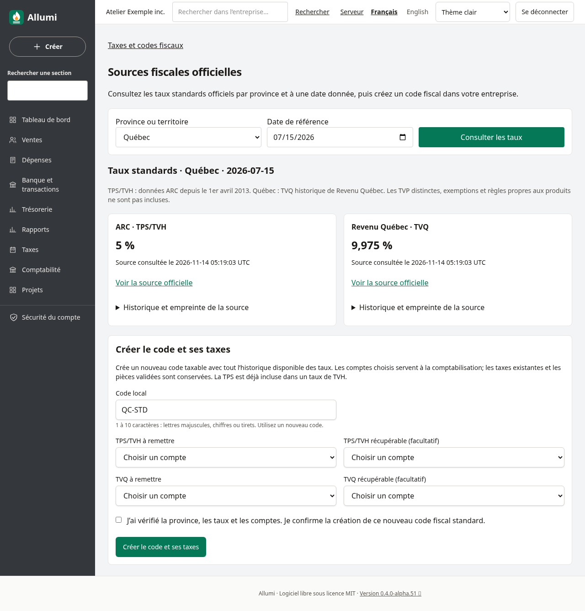
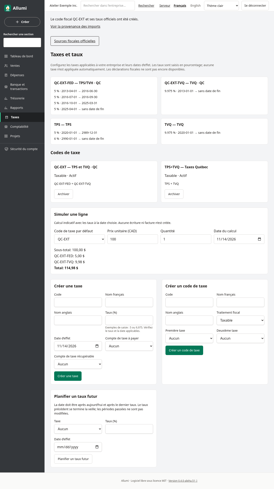
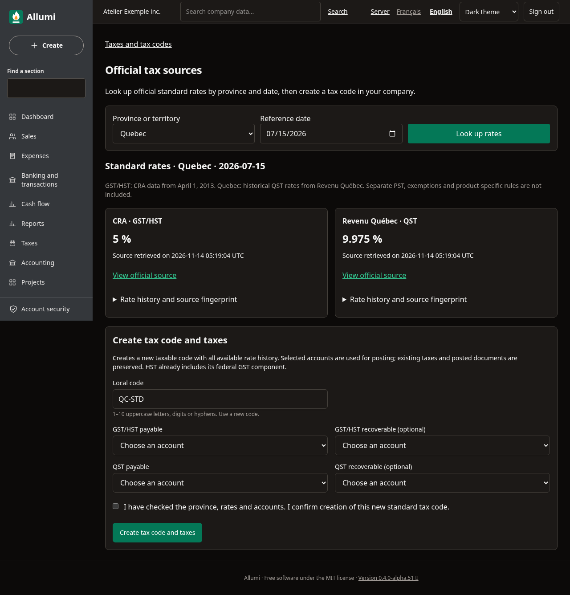
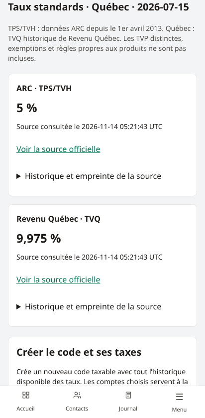
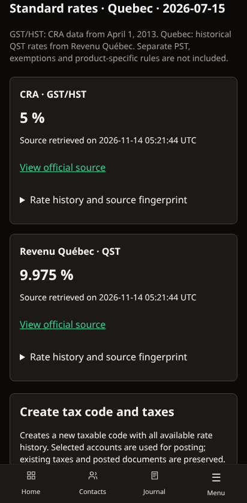
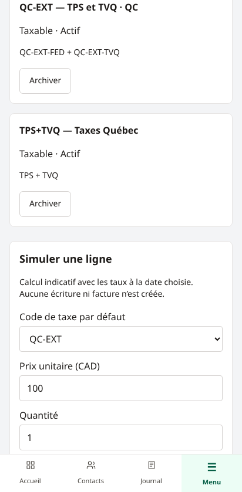

# Sources fiscales officielles

Dans **Taxes → Sources fiscales officielles**, consultez les taux publiés par l’Agence du revenu du Canada et Revenu Québec, puis créez un nouveau code fiscal utilisable dans vos factures, achats et produits.

## Consulter les taux

Choisissez la province ou le territoire, une date entre le **1er avril 2013** et aujourd’hui, puis **Consulter les taux**. Le serveur interroge les sources officielles en HTTPS, sans transmettre vos contacts, transactions ou identifiants d’entreprise.

| Source | Couverture de l’import |
| --- | --- |
| ARC, API des données ouvertes | TPS/TVH pour les 13 provinces et territoires, avec périodes historiques depuis avril 2013 |
| Revenu Québec, historique des taux | TVQ au Québec depuis janvier 2013; le code combiné TPS/TVQ est utilisable à partir d’avril 2013 |

La TVH comprend déjà sa composante fédérale : Allumi importe un seul taux total de TVH. Les colonnes provinciales du jeu ARC ne sont pas ajoutées une deuxième fois. Les TVP distinctes de Colombie-Britannique, du Manitoba et de Saskatchewan ne sont pas fournies par ce connecteur.

Chaque carte affiche le taux applicable à la date choisie, l’heure de consultation et un lien officiel. **Historique et empreinte de la source** présente les périodes et le SHA-256 de la réponse consultée.

## Créer un code fiscal

Un membre avec **Taxes en écriture** et **Comptabilité en lecture** peut importer les taux. Choisissez :

1. Un code local encore inutilisé, de 1 à 10 caractères : lettres majuscules, chiffres ou tirets, par exemple `QC-STD`.
2. Le compte de TPS/TVH à remettre, et son compte récupérable si applicable.
3. Au Québec, le compte de TVQ à remettre et son compte récupérable si applicable.
4. La confirmation après vérification de la province, des taux et des comptes.

Les comptes à remettre doivent être des passifs actifs de taxes de vente; les comptes récupérables, des actifs de taxes de vente. Les comptes appartiennent à l’entreprise courante.

**Créer le code et ses taxes** crée atomiquement les taxes, tous les intervalles historiques disponibles et un code taxable qui les associe. La date choisie sert à la consultation; elle ne supprime pas les autres périodes de l’historique. Au Québec, le code associe TPS et TVQ. Ailleurs, il associe la TPS/TVH fournie par l’ARC; une éventuelle TVP séparée doit être configurée distinctement.

Un code déjà présent est refusé. L’import ajoute des définitions; il conserve les taxes existantes et les pièces validées. Choisissez ensuite le nouveau code sur vos nouvelles factures ou dans les paramètres fiscaux d’un produit. Les produits existants ne sont pas réaffectés automatiquement.

## Provenance et changements de source

La confirmation consulte de nouveau les sources. Si un taux ou une période diffère de l’aperçu, l’import s’arrête et demande une nouvelle consultation. Un changement de mise en page sans changement des taux ne déclenche pas ce refus.

L’événement d’audit `tax.official_import` conserve l’auteur, le code créé, la province, la date de référence, les liens et empreintes des réponses, l’heure de collecte, les taux et leurs périodes. **Voir la provenance des imports**, sur la confirmation, ouvre cet historique pour les membres disposant du droit Audit. Les créations de lignes sont également journalisées.

Si une source est indisponible, trop volumineuse, illisible ou d’un format inconnu, aucun import n’est appliqué. Réessayez ou vérifiez une nouvelle version de l’application si la structure officielle a changé. Le serveur doit pouvoir joindre `open.canada.ca` et `www.revenuquebec.ca` en HTTPS. Aucun compte externe ni clé API n’est nécessaire.

## Téléphone, anglais et périmètre

Les taux et la création sont disponibles en français et anglais, avec thèmes clair et sombre et cartes sur téléphone. La consultation exige **Taxes en lecture**; elle reste disponible sans accès à la Comptabilité. Les utilisateurs ne disposant pas des droits de création consultent les sources en lecture seule.

Ce connecteur crée des codes aux taux standards. Il ne détermine pas la taxation d’un produit, son lieu de fourniture, une exemption ou un droit de récupération partielle. Les catalogues externes de règles de produits/services, la synchronisation planifiée et le dépôt de déclarations restent hors de ce parcours. Les codes détaxés, exonérés et hors champ se configurent dans [[Taxes-et-catalogue]].

Sources : [jeu de données ARC et sa licence ouverte](https://open.canada.ca/data/en/dataset/5584a2cf-12af-4b2d-aff5-418410cf5375), [historique officiel de Revenu Québec](https://www.revenuquebec.ca/fr/entreprises/taxes/tpstvh-et-tvq/regles-de-base-relatives-a-lapplication-de-la-tpstvh-et-de-la-tvq/historique-des-taux/). Les captures utilisent une entreprise fictive et des réponses publiques figées pour les essais; en utilisation normale, l’application consulte les sites officiels.

Voir [[Utilisateurs-et-permissions]], [[Piste-d-audit]] et [[Taxes-et-catalogue]].
