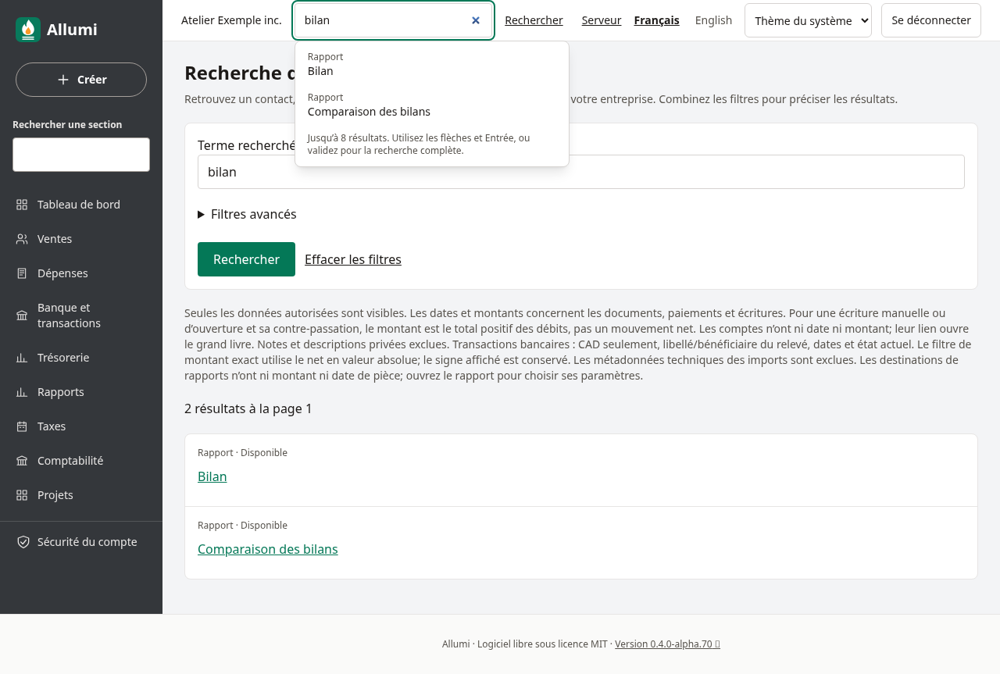
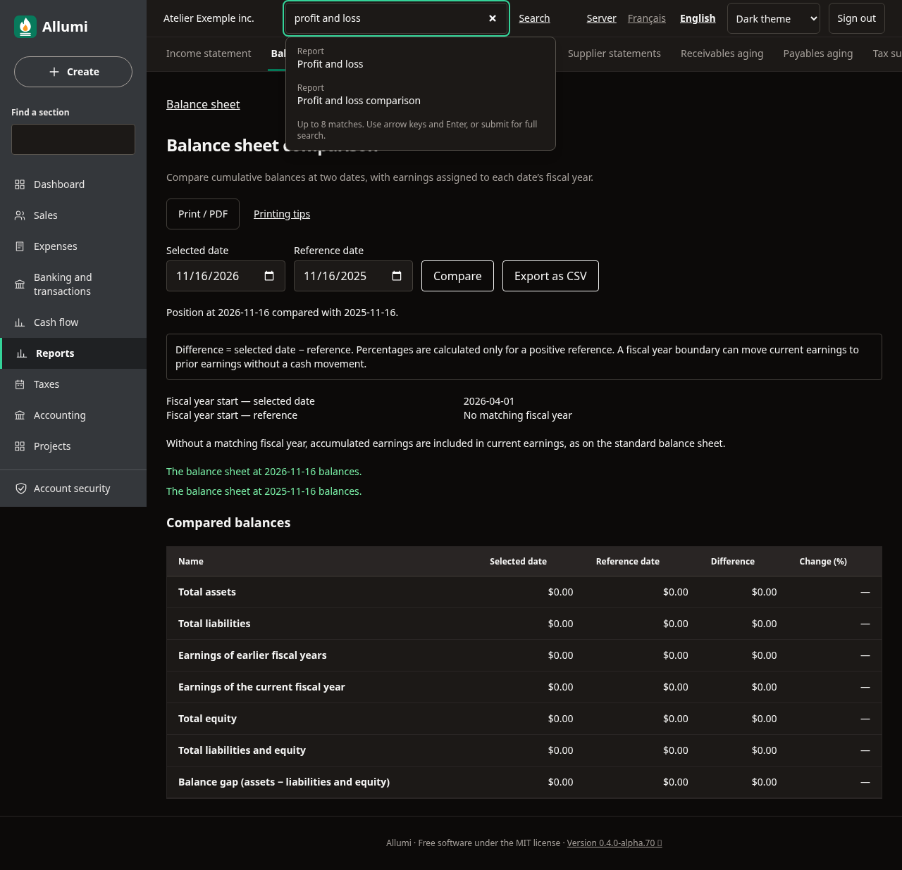
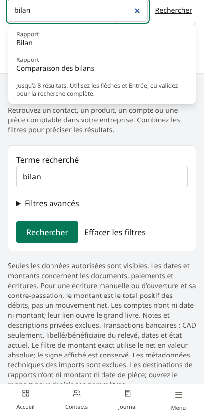
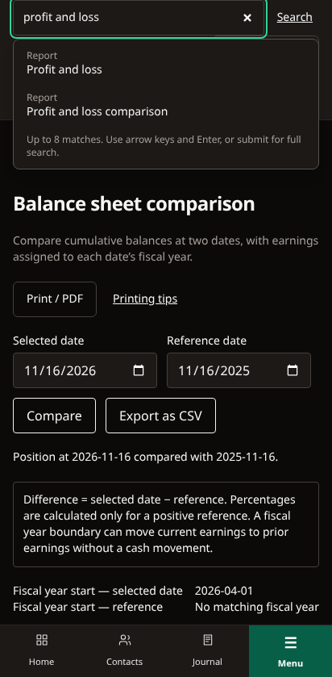

# Suggestions dans la recherche d’en-tête

Le champ de recherche de l’en-tête propose jusqu’à **huit résultats** après au moins deux caractères. Une courte pause de 300 ms limite les requêtes pendant la frappe. Les suggestions utilisent la recherche globale existante et son ordre; ce ne sont ni un classement prédictif ni des recherches récentes.

Les contacts, produits, comptes, pièces, paiements, lignes bancaires CAD et formulaires de rapports déjà pris en charge restent soumis à leurs permissions. La liste montre seulement leur libellé, leur type et leur destination. Pour les pièces, le libellé peut associer numéro et nom autorisé; les dates, montants et autres champs structurés ne sont pas transmis dans cette projection.

## Choisir ou poursuivre la recherche

- **Flèche bas / haut** : parcourir les propositions; le choix actif reste visible dans la liste défilante.
- **Entrée avec un choix actif** : ouvrir cette destination.
- **Entrée sans choix actif**, ou bouton **Rechercher** : ouvrir la recherche complète avec le terme saisi.
- **Échap** : fermer les propositions en gardant le champ et son texte.
- Cliquer ou toucher une proposition ouvre sa destination. Sortir du champ et de ses commandes ferme la liste.

Une absence de suggestion ou une erreur laisse la recherche complète utilisable. Sans JavaScript, le formulaire GET reste disponible; seule la liste automatique manque. Les touches de composition ne valident pas accidentellement une proposition.

La recherche complète conserve ses filtres avancés et sa pagination : [[Recherche-globale]]. Les suggestions ne proposent pas de modifier, payer, supprimer ou comptabiliser une pièce.

## Requêtes et permissions

Les requêtes précédentes sont annulées lorsque le texte change. Une réponse retardée ne remplace pas les résultats d’un terme plus récent; les réponses arrivant après fermeture sont également ignorées. Ouvrir une autre destination, changer d’entreprise ou de langue réinitialise le champ et sa liste.

L’endpoint exige une session entièrement connectée, y compris la deuxième étape lorsqu’elle est activée, et l’appartenance à l’entreprise. Chaque requête reprend les droits courants et la recherche SQL/RLS existante. Les liens de destination recontrôlent leurs accès; un aperçu reçu avant un retrait de permission ne confère aucun droit supplémentaire. Les libellés peuvent contenir des données métier autorisées, notamment des noms ou descriptions de relevés.

Le client ne stocke pas d’historique dans localStorage ou des cookies, et le serveur n’enregistre aucun historique de recherche applicatif. Les réponses sont privées, sans cache, et limitées à l’origine du site. Les termes transitent en GET vers le serveur Allumi et peuvent apparaître dans les journaux du proxy ou du serveur; la validation du formulaire complet peut aussi les laisser dans l’historique du navigateur. Aucun terme n’est envoyé à un moteur externe ou à une IA.

Les réponses ne contiennent ni montants/date de pièce structurés, ni mémos privés ou métadonnées techniques des imports. Les noms présents dans un libellé respectent les mêmes règles que la recherche complète, y compris les identités historiques autorisées des pièces validées.

## Téléphone et périmètre

La liste est utilisable au clavier et au toucher, avec rôles combobox/listbox, choix actif annoncé et messages d’état. Elle possède une hauteur limitée et défile lorsqu’il y a plusieurs résultats. Les langues française/anglaise et thèmes clair/sombre sont conservés.

Les captures utilisent une entreprise fictive dans Chromium en émulation mobile. Les essais physiques Safari iOS restent ouverts. Aucune migration ni nouvelle configuration. L’historique, l’interprétation de phrases et les types de données encore absents de la recherche globale ne sont pas ajoutés.

Voir [[Recherche-des-rapports]], [[Recherche-comptable]], [[Recherche-bancaire]] et [[Utilisateurs-et-permissions]].

## Contrats et liens clients dans la recherche globale

[[Recherche-des-contrats]] décrit le titre, nom du client et référence complète, les étapes de consultation/signature, les dates de création à Toronto et les suggestions vers la fiche interne, sous Ventes lecture.
