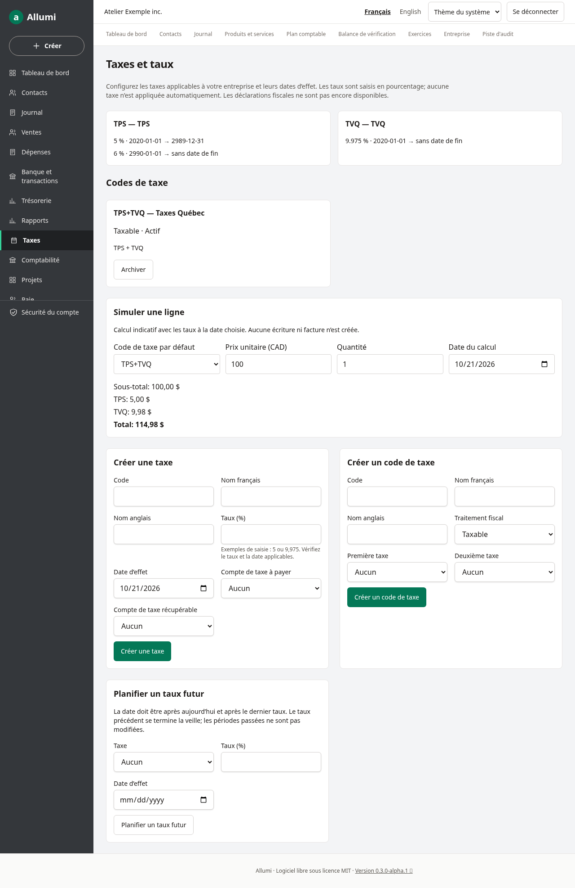
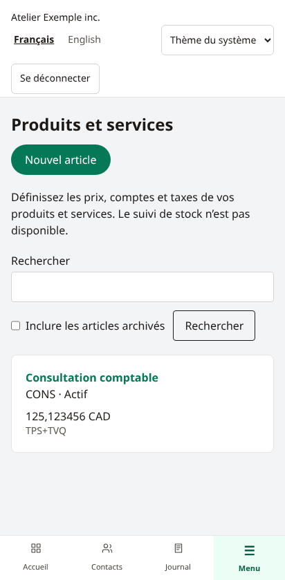
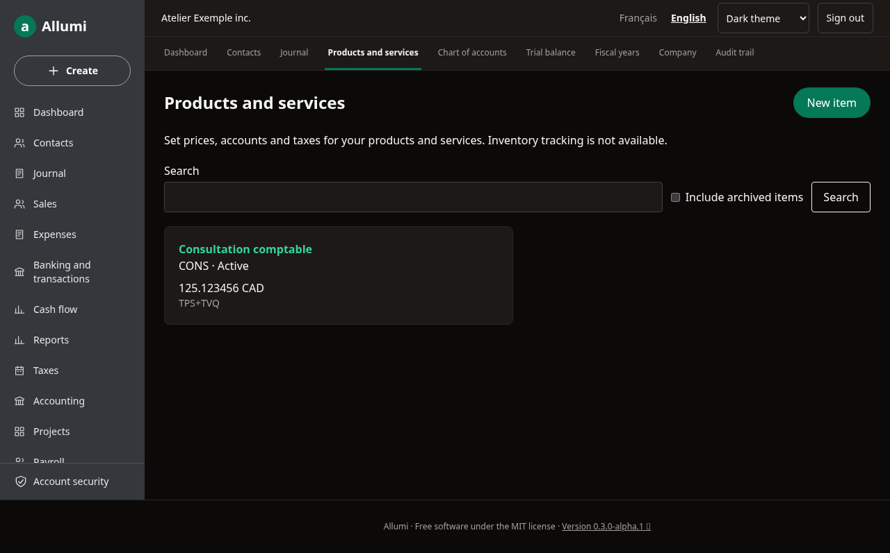

# Taxes et catalogue

Les écrans **Taxes** et **Produits et services** sont accessibles dans la navigation de l’entreprise, y compris le menu mobile. Ils sont disponibles en français et en anglais, en thème clair ou sombre.

## Configurer les taxes

Dans **Taxes**, créez chaque taxe avec un code unique, ses noms français et anglais, son pourcentage et sa date d’effet. Choisissez un compte de passif de sous-type taxe pour les montants à payer et, si nécessaire, un compte d’actif de sous-type taxe pour les montants récupérables. Les comptes doivent être actifs et appartenir à l’entreprise.

Les pourcentages acceptent jusqu’à quatre décimales : saisir `5` signifie 5 %, `9,975` signifie 9,975 %. Aucun régime fiscal ni taux n’est activé automatiquement; vérifiez les taux applicables à votre entreprise.

Créez ensuite un **code de taxe** : taxable avec une ou deux taxes dans l’interface, détaxé, exonéré ou hors champ sans composantes. Les taxes d’un même code s’appliquent indépendamment à la base, sans taxe sur taxe. Un code peut être archivé puis restauré; l’archivage conserve son historique et empêche sa sélection pour de nouvelles fiches.

**Planifier un taux futur** ajoute un taux après aujourd’hui et après le dernier taux enregistré. Le taux précédent se termine la veille. Une modification affectant des documents déjà validés est refusée. Les définitions ne peuvent pas être supprimées depuis l’interface.

## Simuler un calcul

Sélectionnez un code, une date, une quantité et un prix dans **Simuler une ligne**. Le résultat utilise les taux en vigueur à cette date et arrondit au cent. Si un taux manque, aucun total n’est affiché. Cette simulation ne crée ni facture ni écriture comptable.

## Produits et services

Créez un article avec son nom, son code facultatif, son prix en dollars canadiens et, si désiré, ses comptes de revenus et de charges et son code de taxe. Les prix sont positifs ou nuls, avec au plus six décimales. Les calculs utilisent des entiers et des décimaux exacts.

La recherche porte sur le nom et le code. Jusqu’à 100 résultats sont affichés; précisez la recherche au besoin. Une fiche peut être modifiée, archivée ou restaurée. Cochez **Inclure les articles archivés** pour retrouver les fiches archivées.

La consultation du catalogue exige **Catalogue** en lecture, sans accès obligatoire aux taxes ou à la comptabilité. Les codes fiscaux associés sont détaillés uniquement avec **Taxes** en lecture. Les formulaires actuels de modification, qui associent aussi comptes et codes fiscaux, exigent **Catalogue** en écriture, **Taxes** en écriture et **Comptabilité** en lecture; les autres membres autorisés consultent la fiche en lecture seule.

Les accès sont isolés par entreprise et les mutations sont journalisées dans la [[Piste-d-audit]]. Voir [[Utilisateurs-et-permissions]] et [[Recherche-globale]].

## Limites

Ce module prépare la facturation. Il ne crée pas encore de factures ou de déclarations fiscales, ne suit pas les stocks et ne transmet rien aux autorités fiscales. Le moteur prend en charge l’arrondi par ligne ou par document; la simulation montre une seule ligne.

## Captures de référence

Données fictives issues du parcours de test.

Voir aussi [[Contacts]], [[Plan-comptable]] et [[Appearance-and-language]].

## Montants comptabilisés

Le [[Sommaire-des-taxes]] présente les taxes des écritures validées sur une période, indépendamment des taux actuels, avec contrôle et détail. Ce rapport ne dépose pas de déclaration.

## Sources fiscales externes

La configuration des taxes et des codes reste manuelle dans cette version. Aucun taux ni catalogue de règles externes n’est synchronisé automatiquement.

Les références publiques sont le [calculateur et les taux de l’ARC](https://www.canada.ca/en/revenue-agency/services/tax/businesses/topics/gst-hst-businesses/charge-collect-which-rate/calculator.html), le [jeu de données TPS/TVH de l’ARC](https://open.canada.ca/data/en/dataset/5584a2cf-12af-4b2d-aff5-418410cf5375) et les [règles de calcul de Revenu Québec](https://www.revenuquebec.ca/fr/entreprises/taxes/tpstvh-et-tvq/perception-de-la-tps-et-de-la-tvq/calcul-des-taxes/). Ces liens ouvrent les sources officielles; ils ne connectent pas votre entreprise à un fournisseur.

Un taux provincial ne suffit pas à déterminer la taxation de chaque produit ou service. Les codes internes Allumi et les codes d’un catalogue externe sont des identifiants distincts; aucun rapprochement automatique n’est appliqué aux pièces existantes.
