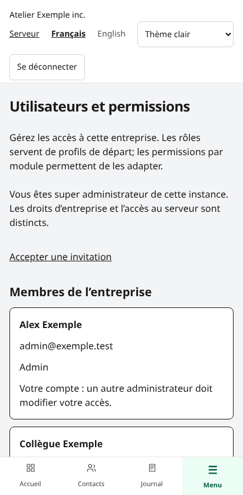
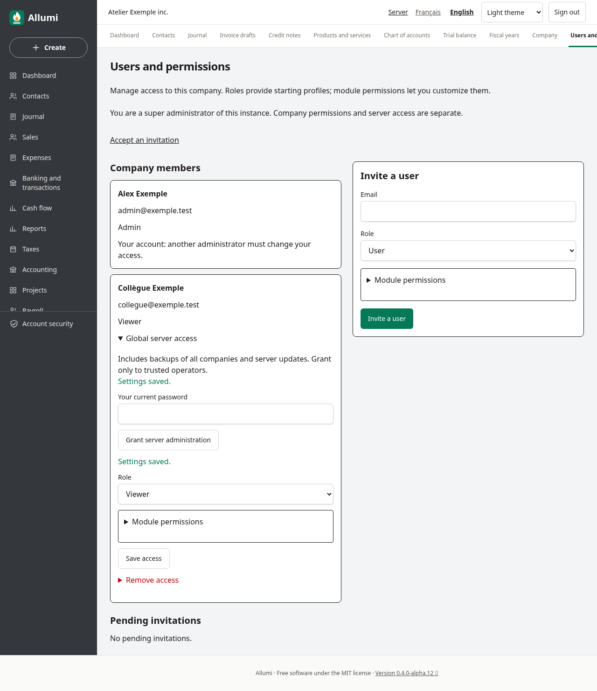

# Utilisateurs et permissions

Dans le menu de l’entreprise, **Utilisateurs et permissions** est réservé à ses admins. L’organisation distingue les responsabilités globales du serveur et celles de chaque entreprise. Les profils et accès modulaires s’inspirent des usages des logiciels comptables; ils ne constituent pas une reproduction exacte d’une édition QuickBooks.

| Profil | Accès par défaut |
| --- | --- |
| Super admin | Administrateur de l’instance créé au premier démarrage; peut déléguer l’administration du serveur. Ses accès aux entreprises restent distincts. |
| Admin | Tous les modules de son entreprise, invitations, rôles et permissions. En base : `OWNER`. |
| Utilisateur | Modification des contacts et produits/services; consultation des ventes, comptabilité et taxes; aucun audit par défaut. |
| Lecteur | Consultation; jamais de modification métier, même si une permission « Modification » est sélectionnée. |
| Comptable externe | Opérations comptables et audit; pas de gestion des utilisateurs, des clés Stripe/PayPal, ni du serveur par défaut. |

Le comptable externe a son propre compte et peut appartenir à plusieurs entreprises avec des permissions différentes. « Externe » désigne son rôle : il ne donne aucun accès public ni accès à distance supplémentaire.

## Inviter une personne

1. Saisir son courriel, choisir son rôle et, au besoin, ouvrir **Permissions par module**.
2. Cliquer sur **Inviter un utilisateur**. Copier le code affiché une seule fois, puis le transmettre par un canal privé.
3. La personne ouvre `/invitation` sur votre serveur et saisit ce code. Un nouveau compte choisit son propre mot de passe (12 caractères minimum). Une personne ayant déjà un compte se connecte d’abord avec celui-ci, termine sa double authentification puis revient sur `/invitation`.

Aucun courriel n’est envoyé automatiquement. Le code expire après sept jours. Seule son empreinte est conservée; ni le code ni son empreinte ne figurent dans l’audit. Une nouvelle invitation au même courriel dans la même entreprise invalide la précédente. L’acceptation est unique, y compris lors de deux envois simultanés. Elle ne remplace jamais le mot de passe ou le rôle d’un compte déjà membre.

## Adapter les permissions

Chaque module propose **Selon le rôle**, **Aucun accès**, **Lecture** ou **Modification** : contacts, produits/services, ventes/factures, comptabilité/rapports, taxes et audit. Les règles s’appliquent dans les services et dans PostgreSQL, y compris en accédant directement à une URL.

- La modification des ventes exige la modification de la comptabilité et au minimum la lecture des contacts, produits et taxes, pour créer les écritures cohérentes d’une facture.
- La lecture des ventes exige la lecture des contacts, du catalogue, de la comptabilité et des taxes.
- La lecture ou modification du catalogue exige la lecture de la comptabilité et des taxes; les taxes exigent la lecture de la comptabilité.
- L’audit exige au minimum la lecture de tous les modules : il peut contenir leur historique.
- Les admins gardent tous les droits; les lecteurs restent plafonnés à la lecture. La gestion des utilisateurs, l’anonymisation, la clôture/réouverture privilégiée et les clés des intégrations restent réservées aux admins.

Un module masqué ne supprime pas ses données déjà présentes dans les documents d’un autre module : par exemple, une facture conserve son identité client comptable.

## Modifier ou retirer un accès

Enregistrer un nouveau rôle ou des permissions prend effet à la requête suivante, sans attendre la déconnexion. **Retirer l’accès** demande confirmation et retire uniquement l’adhésion à l’entreprise : le compte global, les autres entreprises, les écritures et l’audit restent conservés. Les invitations émises par un admin retiré ou rétrogradé sont révoquées.

On ne modifie pas son propre accès dans cet écran; un autre admin le fait. La base protège également le dernier admin de l’entreprise. Une invitation peut être révoquée séparément tant qu’elle n’a pas été acceptée.

## Administration du serveur

Le super admin peut ouvrir **Accès global au serveur** dans la fiche d’un membre et confirmer son propre mot de passe pour accorder ou retirer ce droit. Il donne accès aux sauvegardes **de toutes les entreprises**, aux paramètres non secrets, au journal d’administration et aux mises à jour du serveur. Un admin d’entreprise ne peut pas se l’accorder lui-même. Voir [[Administration-serveur]].

## Captures

