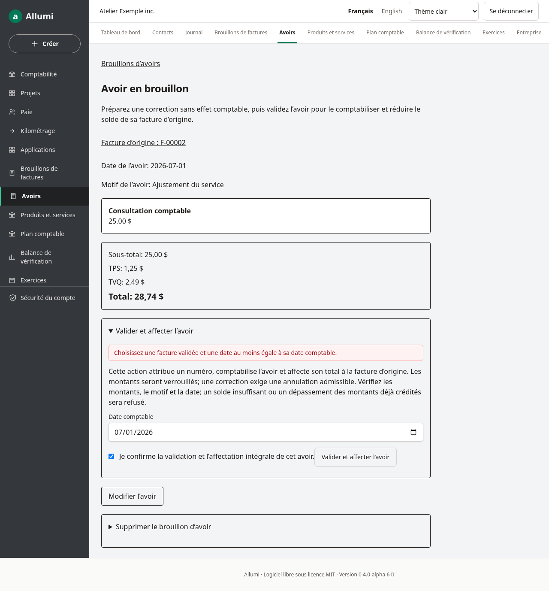
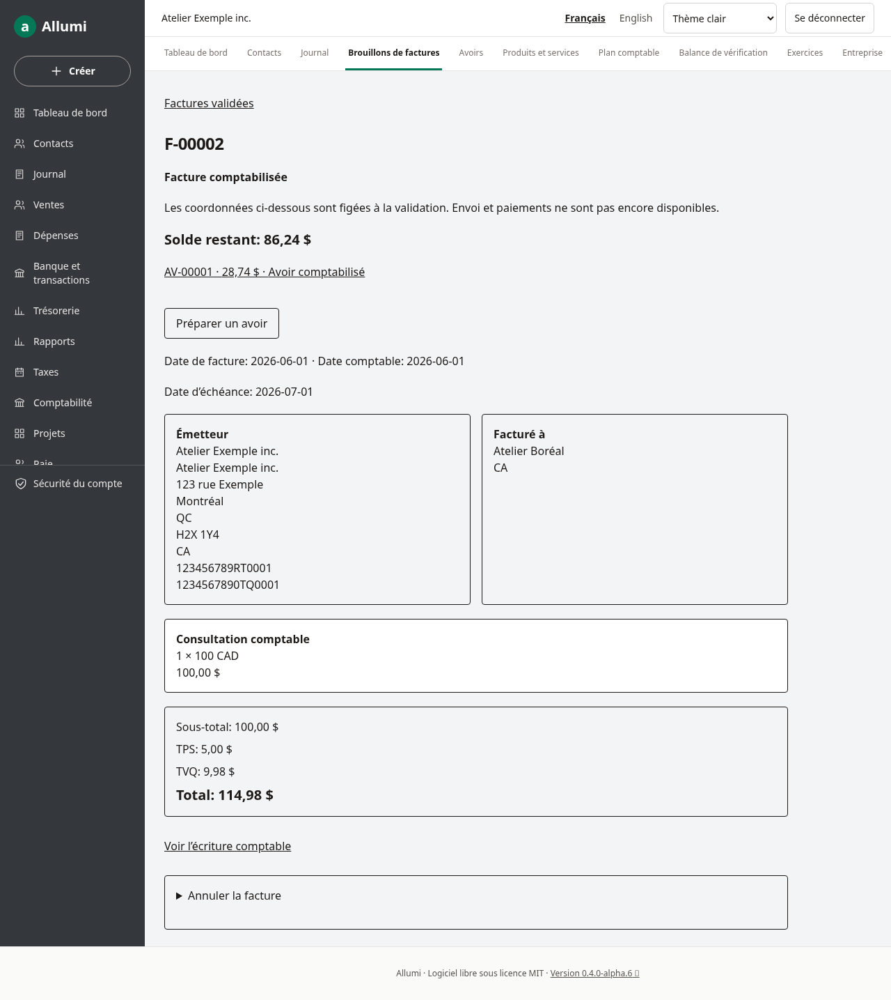

# Validation et affectation des avoirs

Un avoir validé corrige une facture comptabilisée : il réduit les revenus et les taxes collectées, crédite le compte clients, puis est entièrement affecté à sa facture d’origine. Cette préversion est réservée aux données fictives.

## Valider un brouillon

1. Préparer un [[Brouillons-d-avoirs]] depuis une facture validée. Vérifier les montants hors taxes, le motif et les taxes calculées aux taux de la facture d’origine.
2. Sur la fiche du brouillon, ouvrir **Valider et affecter l’avoir**. Seuls le propriétaire et le comptable peuvent valider.
3. Choisir une date comptable au moins égale à la date de l’avoir, dans une période ouverte. La date de l’avoir ne peut précéder la date comptable de la facture.
4. Lire l’avertissement, cocher la confirmation et valider. Les montants seront verrouillés; une correction passe par une annulation admissible.

L’application attribue un numéro `AV-…`, crée une écriture équilibrée et affecte le total de l’avoir à la facture d’origine dans une transaction. Les coordonnées figées de la facture sont conservées sur l’avoir. Une demande répétée retourne le même avoir, sans deuxième écriture ni affectation.

## Consulter le résultat

Le menu **Avoirs → Avoirs validés** affiche les 100 derniers documents validés ou annulés. Les lecteurs peuvent consulter. La fiche conserve le motif, les lignes, les taxes, la date comptable, les affectations actives ou retirées et le lien vers le journal. Aucun bouton de modification ou suppression n’est proposé.

La facture d’origine affiche son **solde restant** et un lien vers l’avoir. Exemple : une facture de 114,98 $ corrigée par un avoir de 28,74 $ présente un solde de 86,24 $. Son total original reste inchangé.

## Annuler un avoir

Le propriétaire ou le comptable peut ouvrir **Annuler l’avoir**, saisir un motif de 1 à 500 caractères et choisir une date dans une période ouverte. Cette date ne peut précéder la comptabilisation, une affectation ou un retrait déjà enregistré. Cocher la confirmation puis valider.

L’opération retire les affectations encore actives à la facture d’origine et crée la contre-passation exacte de l’écriture, taxes et contact compris. Tout réussit ensemble ou rien ne change. Un double envoi ne crée pas une deuxième écriture. La facture retrouve le montant correspondant dans son solde restant; son total original reste inchangé.

Un remboursement actif ou une affectation active vers une autre facture bloque l’annulation. Le parcours ne les retire jamais automatiquement. Une affectation déjà retirée conserve sa date et son auteur. La désaffectation autonome n’est pas proposée.

L’avoir conserve son numéro, ses montants, son motif initial et son écriture d’origine. Le bandeau indique le motif d’annulation, sa date et le lien vers l’écriture inverse. L’historique indique les affectations retirées. Les avoirs annulés restent visibles dans la liste et sur la facture, avec leur statut.

## Refus et limites

- Les avoirs validés cumulés ne peuvent dépasser une ligne originale, une taxe ou le total de la facture. Les comptes, positions et codes de taxe des lignes doivent correspondre à l’original.
- Les taxes restent calculées aux taux d’origine, avec le mode d’arrondi de la facture. Si plusieurs petits avoirs dépassent une taxe originale à cause des arrondis, la validation est refusée. Aucun ajustement fiscal silencieux n’est effectué.
- Le solde disponible doit suffire pour affecter **tout** l’avoir. Une facture déjà réglée, ou un solde partiellement utilisé, peut empêcher l’opération. Aucune affectation partielle, autre facture cible ou remboursement n’est proposé dans ce parcours.
- Une révision périmée, un manque de permission, une facture annulée ou une période fermée entraîne un refus. Le brouillon reste disponible et aucun numéro n’est consommé.
- Un avoir validé lié empêche l’annulation de la facture d’origine. L’annulation de l’avoir retire ses affectations d’origine et lève ce blocage. Désaffectation autonome, réaffectation, remboursements, PDF et envoi restent à venir. Ne pas modifier la base pour contourner ces contrôles.

La migration `20261024000000_credit_posting` est nécessaire; les installations et mises à jour standard l’appliquent via le service de migration. Voir [[Mise-a-jour]] et [[Schema-de-donnees]].
